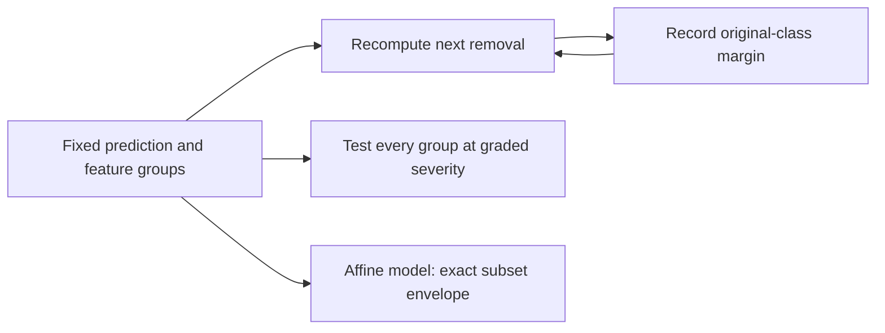

# Counterfactual Fragility Certificates
### For Tabular Classifications: Guarantees and Limits

**Which missing or degraded inputs can overturn a model decision?**

CFC audits a fixed model under a declared feature-failure protocol. The current manuscript combines a removal path that recomputes group effects after every step, separate graded tests of every group, and an exact minimum-removal result for affine class scores.

[Recomputed search and affine solver](explorer/reference.py) · [Runnable example](explorer/demo.py) · [Earlier artifact](LEGACY_README.md) · [Version map](explorer/PROVENANCE.md)



## Algorithmic contributions

**Recompute after each removal.** Redundant fields can mask one-step effects. At each step, evaluate all remaining groups against the current altered input and remove the group that most reduces the original-class margin. Keep the original class anchored even after a flip.

**Test partial degradation separately.** Removing a field entirely can behave differently from degrading it. The new example independently attenuates each group toward a fixed baseline at five severities. This demonstrates one operator; it does not implement the manuscript's entire failure family or FDS.

**Solve affine removal depth.** For known affine class scores and a fixed baseline, a rival's margin reduction is additive across disjoint groups. Sort its positive contributions and find the first prefix that defeats the original class; minimize over rivals. The mathematical result covers all subsets in this declared removal family, in `O(Cd + CG log G)` time.

## Run the paper-aligned reference examples

```bash
git clone https://github.com/cenacchi2000/Counterfactual-Fragility-Certificates.git
cd Counterfactual-Fragility-Certificates
python -m venv .venv
source .venv/bin/activate
pip install numpy
python explorer/demo.py
python -m unittest discover -s explorer/tests -v
```

The demo prints the recomputed removal trajectory, independent attenuation tests, and the affine minimum-removal witness. The tests compare the affine solver with exhaustive subset enumeration on small random models.

| Code | Purpose |
|---|---|
| [`removal_path`](explorer/reference.py) | Recompute every remaining group's effect at every step |
| [`graded_tests`](explorer/reference.py) | Independently test each group at each declared attenuation severity |
| [`affine_minimum_removals`](explorer/reference.py) | Minimum grouped baseline-removal depth, with smallest-index class tie rule |
| [`src/cfc_ref/`](src/cfc_ref) | Earlier compact implementation, preserved for version transparency |

