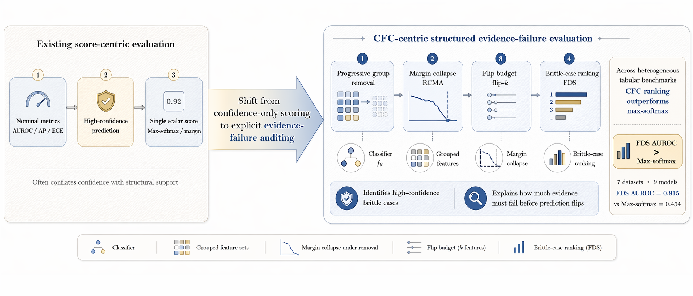
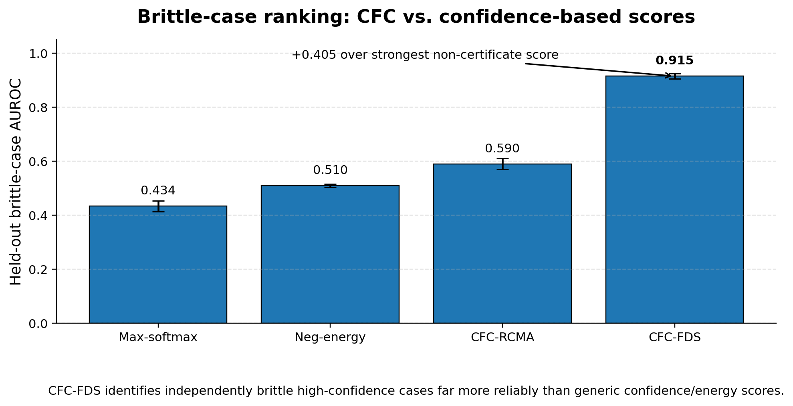

# Counterfactual Fragility Certificates

<p align="center">
  
</p>

> **Counterfactual Fragility Certificates: Exposing High-Confidence Brittleness under Structured Evidence Failure**

CFC is a protocol-relative audit object for tabular predictions. Instead of asking only whether a prediction is confident, it asks:

> **Under a declared evidence-failure protocol, what ordered trajectory makes this prediction lose support?**

The artifact contains a compact reference implementation, precomputed result tables, selected figures, and reproduction scripts for the main audit evidence. 

---

## Research contributions

High confidence does not establish that a prediction remains supported when part of its evidence becomes unavailable or unreliable. CFC addresses this gap by turning structured evidence-failure tests into an inspectable, per-prediction audit record.

### 1. A recomputable evidence-failure certificate

CFC records how a model responds as declared feature groups are removed or degraded. Each certificate includes the tested group order, prediction margins, the first observed class flip, and degradation thresholds.

This makes the audit inspectable: a researcher can examine which evidence was changed, how the model responded, and which protocol produced the result.

**Scope:** CFC is a protocol-relative audit certificate, not a formal guarantee of robustness against every possible perturbation.

### 2. Complementary measures of prediction fragility

The certificate summarises different aspects of evidence dependence:

- **Flip budget:** how many groups along the tested removal trajectory are needed to change the predicted class.
- **RCMA:** how strongly the prediction margin collapses along that trajectory.
- **Degradation thresholds:** the tested severity at which a declared degradation operator changes the prediction.
- **Fragility Dominance Score (FDS):** a fixed combination of these signals for prioritising predictions for review.

Together, these measures distinguish abrupt prediction failure from gradual loss of support. Their interpretation depends on the feature grouping, replacement baseline, audit depth, and degradation operators.

### 3. Empirical evaluation beyond ordinary confidence scores

The associated paper evaluates whether CFC identifies independently defined brittle high-confidence cases across seven tabular benchmarks and linear, tree-based, boosting, and neural models.

Reported aggregate results include:

- **0.915 AUROC** for CFC-FDS, compared with **0.510** for the strongest non-certificate score in the reported comparison.
- **88.9% capture** of brittle high-confidence cases within a **20% review budget**, compared with **31.8–37.4%** for confidence and energy scores.

These results support using structured evidence-failure information to prioritise review. They measure brittleness detection under the evaluated protocols, rather than ordinary classification accuracy or clinical effectiveness.

### 4. An inspectable reference implementation

This repository exposes the certificate computation, a demonstration workflow, and scripts for recreating tables and figures from supplied precomputed results.

The compact implementation ranks groups by their individual margin effects, then evaluates cumulative removal along that fixed order. Its default graded-degradation check attenuates the highest-ranked group toward the baseline.

This release therefore supports inspection of the computational core and recreation of reported summaries. Recreating a table from supplied CSVs is distinct from independently rerunning the paper's complete training and evaluation grid.

## What is included

| Folder | Contents | Purpose |
|---|---|---|
| `src/cfc_ref/` | compact reference implementation of the CFC certificate | lets reviewers inspect the core computation |
| `data/precomputed/` | anonymous CSVs for headline tables and appendix checks | reproduces reported numbers without rerunning the full grid |
| `assets/figures/` | selected paper figures and visual summaries | makes the artifact readable and visually inspectable |
| `scripts/` | small scripts to regenerate demo certificates, tables, and figures | quick sanity checks for reviewers |
| `paper_snippets/` | core LaTeX equations | maps implementation to paper notation |
| `docs/` | GitHub Pages style artifact card | optional visual landing page |

The full production training grid is intentionally not included in this blinded artifact. This review version exposes the **auditable certificate core** and **reproduction-facing outputs** while removing author-specific paths, machine metadata, and private orchestration code. A full unblinded release will be made after review.

---

## Main result at a glance

| Ranking score | Aggregate AUROC | 95% CI | Δ vs. strongest non-certificate score |
|---|---:|---:|---:|
| Neg-energy | 0.510 | [0.504, 0.516] | best non-CFC |
| CFC-RCMA | 0.590 | [0.570, 0.610] | +0.080 |
| **CFC-FDS** | **0.915** | **[0.905, 0.925]** | **+0.405** |

Under a 20% review budget, CFC-FDS captures **88.9%** of brittle high-confidence cases, compared with **31.8–37.4%** for confidence and energy scores.

<p align="center">
  
</p>

---

## Core certificate

For a sample `x`, trained model `f`, grouped features `G`, baseline `xbar`, audit depth `K`, and degradation operators `P`, CFC stores:

```text
C(x; f, G) = (trajectory, flip_budget, RCMA, degradation_thresholds, FDS)
```

The default ranking head is fixed, not learned per dataset:

```text
FDS(x) = 1 - exp(-u(x))
u(x) = (RCMA(x) + 1 / flip_budget(x) + mean_degradation_flip_risk(x)) / 3
```

All confidence, margin, and energy baselines use a standardized probability-to-pseudo-logit conversion, making comparisons fair for neural, linear, tree-based, and boosting models.

---

## Quick start

```bash
python -m venv .venv
source .venv/bin/activate  # Windows: .venv\Scripts\activate
pip install -e . -r requirements.txt

python scripts/quick_demo.py
python scripts/reproduce_tables.py
python scripts/make_figures.py
pytest -q
```

Generated outputs are written to:

```text
results/demo_certificate.json
results/tables/tables.md
results/figures/recreated_score_comparison.png
results/figures/recreated_greedy_diagnostics.png
```

---

## Expected smoke-test output

`python scripts/quick_demo.py` prints one CFC certificate with fields:

```json
{
  "predicted_label": 1,
  "confidence": ...,
  "group_order": [...],
  "flip_budget": ...,
  "rcma": ...,
  "degradation_thresholds": {...},
  "fds": ...,
  "margins": [...]
}
```

---


This is a **open source artifact** containing:

- the reference CFC computation;
- the score-conversion and brittle-label protocols;
- curated precomputed tables used in the paper;
- selected figures and result recreation scripts;
- smoke tests that verify the implementation is runnable.

The paper's full grid includes heavier training, model selection, and orchestration code. 
